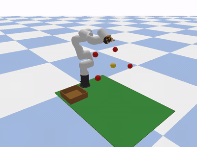
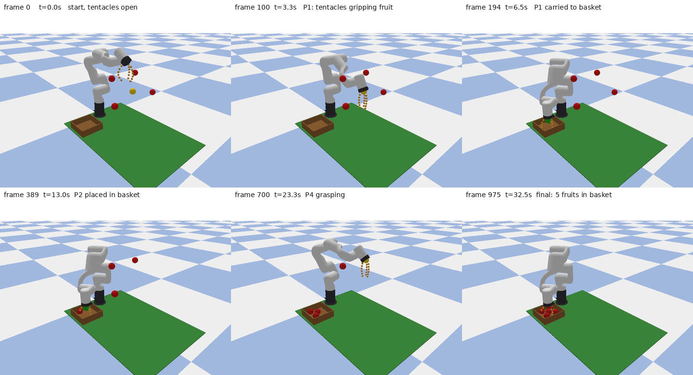

# xArm6 草莓定点到达仿真（WSL2 + PyBullet）

课设《设施草莓采摘仿生机械臂控制系统设计》的定位精度仿真验证部分。唯一执行基线为同目录《实验指导书_xarm6草莓定点到达.md》。

## 范围声明

- 纯仿真；不制实物、**不建模末端执行器**（夹爪按机械图纸设计，未纳入本轮运动学验证）；
- 不含夹爪开合、采摘接触力学、状态机、视觉/CLIP、力控；
- 精度验证对象只有一件事：6 轴 xArm6 的末端 link（link6）依次到达 **5 个写死的空间目标点**；
- 方法为 PyBullet + 内置 `calculateInverseKinematics` 位置-only IK（不约束姿态）；
- 仿真动力学为无重力设定（`setGravity(0,0,0)`）+ 轨迹段速度前馈，验证轨迹规划与位置伺服的指令跟踪与定位收敛；重力负载前馈补偿属实物化后续工作；
- **演示层抓放循环（2026-11-06 纳入范围）**：每个草莓点到位后，追加一段「仿生触手合拢夹取 → 移到篮子 → 末端下降放果 → 果实入篮留存 → 前往下一点」的轨迹，形成 抓-放-抓 的采摘观感。**叙事口径：图纸与说明书讲仿生触手机构结构，仿真只用通用 6 轴平台验证控制流程**。触手是 3 根 × 6 段纯视觉体（L1 视觉合拢示意，几何为示意值、非中科大实物参数），不是 URDF 末端执行器、不进运动学链；篮子与果实搬运也是纯视觉示意：无夹爪、无接触/约束、无夹持力、无力控、不约束末端姿态（「低头」以末端位置下降表达），不写入 CSV、不参与两重静态判定与伺服跟踪判定，也不代表抓取成功率或果实识别能力。

## 演示素材（答辩可用）

> 以下动图与图片均由 **2026-11-06 L1 版同一次完整运行**（`results/reach_demo.mp4`，976 帧 / 960×720 / 32.53 s）派生；画面已**抽样判读 6 帧**（第 0/100/194/389/700/975 帧，覆盖触手合拢与入篮），非全量逐帧校验。答辩引用数字一律以 `results/reach_results.csv` 与《实验指导书》**v6** §8.3 为准。



**关键帧拼图**（6 帧覆盖起始、P1 到达、P1/P2/P4 入篮、终态；PPT 一页讲清全过程）：



| 素材 | 内容 | 规格 | 建议用途 |
|------|------|------|----------|
| `results/reach_demo.gif` | 循环动图，5 颗果实逐颗抓放 | 400×300 / 195 帧 / 6 fps / 337 KB | README 自动播放、现场快速展示 |
| `results/reach_demo.mp4` | 完整运行录像（含 5 段触手夹取 + 抓放） | 960×720 / 976 帧 / 30 fps / 32.53 s / 1.7 MB | 答辩现场播放、备用录屏 |
| `results/reach_keyframes.png` | 6 帧拼图（含帧号、时间戳与抓放阶段） | 1440×780 / 193 KB | PPT 过程页 |
| `results/scene.png` | 终态截图（5 颗果实全在篮中） | 960×720 / 28 KB | 结果页配图 |
| `results/reach_results.csv` | 逐点误差与收敛数据（仍 5 行、20 列） | 749 B | 答辩数字唯一来源 |

**画面语义（答辩务必说清，避免误读）**：红球 = 待到达目标点、黄球 = 当前正在到达的目标、绿球 = 已通过判定的目标；棕色开口箱 = 篮子，绿色薄板为栽培架示意，蓝白棋盘为仿真地面。果实到位后随末端移动到篮内并按序留存，终态 5 颗全在篮中。这些球是**位置标记，不是草莓外观或果实模型**；画面中无夹爪 / 末端执行器，果实搬运为纯视觉移动，**不含抓取接触、夹持力或接触力学**；「低头放果」只是末端位置下降，不约束末端姿态。本轮精度验证的仍是 link6 原点依次到位（无重力设定下的轨迹跟踪与定位收敛），不是抓取成功率或果实识别。

**建议口径**：现场播 MP4（或看动图）+ 关键帧拼图讲「梯形轨迹规划 + 位置伺服」两层结构，再说明触手合拢与抓放循环只是流程可视化；数字只引用 `err_track` 0.29–0.88 mm < 5 mm、5/5 收敛、976 帧 / 133.6 s；主动声明无重力设定、触手为示意几何与范围边界（指导书 §0 / §12 / §14）。另见 `答辩材料/答辩材料包_20261106.zip`（自制图纸 + CAD 三视图 + 仿真素材 + 来源清单）。

## 当前状态（截至 2026-11-06 23:26）

### 已实测

- WSL2 Ubuntu，默认用户 `slphy_kai`，项目路径 `/home/slphy_kai/xarm_lab`；
- conda `robot` 环境：Python 3.11.18、pybullet 3.2.7（manylinux cp311 wheel）、numpy 2.4.6、imageio 2.38.1、imageio-ffmpeg 0.8.1、pillow 13.0.0；
- `import pybullet / numpy / imageio / imageio_ffmpeg / pybullet_data` 全部通过（`IMPORTS_OK 202010061 2.4.6 2.38.1`）；
- 工程文件就位：`xarm6_reach.urdf`、`test_load.py`、`xarm6_reach_demo.py`、`meshes/xarm6/visual/` 下 7 个 STL；
- `test_load.py` 加载自检：`== ALL PASS ==`，6 关节限位逐项 PASS、末端 link 名 link6、零位 FK `(0.2070, -0.0000, 0.1120)` m（|Δ| 0.00 mm）、帧缓冲 307200 bytes；
- 快速验证 / 负向验证（2026-11-06）：5/5 点通过、负向模式退出码 2；
- **完整运行（L1 版 2026-11-06 23:21:09 → 23:23:24）**：5/5 点到达，`err_ik` / `err_track` 0.29–0.88 mm（与 11-04 基线逐点完全一致，含 `converge_step=59`），976 帧 @ 960×720，渲染耗时 **133.6 s**，全程耗时 **133.8 s**；`render_time_s=133.581`；演示层 5 段抓放 + 3 根 × 6 段触手视觉合拢示意，放果点 IK 残差 0.97 mm、限位 5/5 OK；`FULL_EXIT=0`；
- MP4 实测可完整解码 976 帧（30 fps / 32.53 s）；画面抽样判读 6 帧：触手随末端合拢、篮子与果实入篮清晰可见，终态篮中 5 颗；派生 GIF（195 帧 / 375 KB）与关键帧拼图已校验；自制答辩材料包 `答辩材料/答辩材料包_20261106.zip`（3.3 MB）已生成。

### 未实测（不得当作结论引用）

- 降级渲染分支（`--res 640x480 --every 16`）的实际耗时；
- `--threshold` 换阈值复跑；
- 全新机器按指导书从零环境复跑（零探索验证 Task 6）；
- MP4 画面内容的**全量逐帧**人工判读（已完成 6 帧抽样，非全量，不作逐帧正确性结论）；
- 真实抓取 / 接触 / 夹持力、带重力场景（均在本实验范围外）。

以上实测数字见 `results/reach_results.csv` 与《实验指导书》v5 §8.3 / §14；未执行项目一律记作「未执行」。

## 一键复跑

```bash
conda activate robot
cd ~/xarm_lab
python test_load.py                              # 模型加载自检，须 ALL PASS
python xarm6_reach_demo.py --no-video            # 快速验证：只出 CSV + 截图
python xarm6_reach_demo.py --check-out-of-range  # 负向验证：预期退出码 2
python xarm6_reach_demo.py                      # 完整运行：CSV + MP4 + 截图
```

固定解释器路径（免激活 conda）：`/home/slphy_kai/miniconda3/envs/robot/bin/python`。脚本依赖相对路径的 URDF / meshes / results，**必须在 `~/xarm_lab` 目录内执行**。

阈值默认 5 mm（`--threshold` 可配）；渲染降级用 `--res 640x480 --every 16`。完整参数含义与数值来源见实验指导书附录 B。

## 目录

| 路径 | 说明 |
|------|------|
| `xarm6_reach.urdf` | 手写 6 轴 URDF，数值来源见指导书附录 B |
| `test_load.py` | 加载自检（关节数 / 限位 / 零位 FK / 渲染通路） |
| `xarm6_reach_demo.py` | 主实验：IK + 梯形轨迹 + 位置伺服 + 动画与 CSV |
| `meshes/xarm6/visual/` | xarm_ros 官方 7 个 STL |
| `results/` | 实验产物与演示素材（CSV / MP4 / GIF / 关键帧拼图 / 终态截图） |
| `答辩材料/` | 自制答辩材料包 zip（控制框图 / Tool IO 接线 / 电源 / 绳驱 / CAD 三视图 / 仿真素材 / 来源清单） |
| `实验指导书_xarm6草莓定点到达.md` | 唯一执行基线 |
| `课设计划_v3.md` / `运行日志_20261104.md` | 计划与实跑日志快照 |
