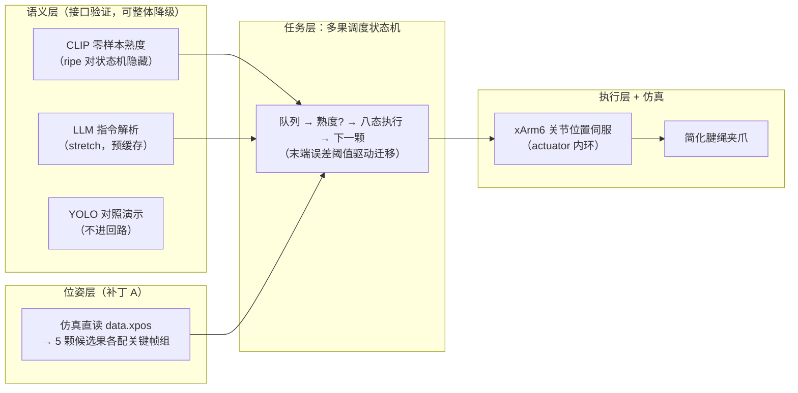

# 设施草莓采摘仿生机械臂课设 · 最小通过计划

> **【v5 口径同步 · 2026-11-06】** 按用户要求，本轮仿真在 5 个定点到达之间加入**演示层抓放循环**（到达草莓点 → 末端下降放果 → 果实视觉入篮留存 → 前往下一颗），已正式纳入实验范围并全量重跑（976 帧 / 134.2 s，5 点误差与 v4 逐点一致）。该层为**纯视觉示意**：仍不含夹爪、采摘接触力学、状态机、视觉/CLIP、力控，不约束末端姿态；到位误差判据、阈值与 CSV 口径不变。当前唯一执行基线为《实验指导书_xarm6草莓定点到达.md》**v5**（§0 第 7 条、§14.3）。本计划排期与答辩策略仍可参考，涉及旧仿真流程的表述均为历史记录。

> **【状态：部分作废 · 2026-11-04】** 本计划 §5 中 D2–D3 的实现方式（原有现成模型仓库 + 每果手调关键帧 + 多果调度状态机）**已被整体取代**，取代方案为"PyBullet + 内置 IK + 5 个写死目标点"。实验执行与说明书叙事的**唯一基线**是《实验指导书_xarm6草莓定点到达.md》（工作区根）。引擎口径（PyBullet）、误差定义（link6 原点，双误差列）、目标点位（P1–P5 本文档原值）、力矩口径（分关节 163.2/163.2/81.6/81.6/30.6/30.6 N·m，一刀切 150 作废）一律以指导书为准。本计划的排期框架与答辩叙事策略仍可参考，但**写说明书时不得引用本文档的旧引擎 / 关键帧 / 夹爪 / 状态机表述**：以下涉及旧选型的表格与排期条目均为历史记录，已按验收硬要求统一为单引擎（PyBullet）口径。

**核心策略：叙事主线交回控制系统与图纸口径；多模态降为"接口验证"辅助亮点；先保命闭环、后语义亮点；所有数字口径自洽，仿真里没有的量绝不写进日志。**

| 项目 | 内容 |
|---|---|
| 目标 | 以最小有效工时通过课设、11 月 20 日答辩不露馅；其余时间用于多模态 / 大模型学习 |
| 硬性交付 | 1 张 A0 图纸 + 5000 字说明书 + 可运行仿真 + 演示材料 |
| 课设叙事主线 | 控制系统完整性（状态机 + 两层控制口径）+ 图纸/说明书口径自洽 |
| 个人学习主线 | 多模态、大模型（Transformer、LLM、VLM）——时间大头在学习，课设只取"CLIP/LLM 接口验证"一个重合点 |
| CV 策略 | 只学导论；YOLO 由 AI 编程助手代工，**检测框不进控制回路**，仅作离线对照演示 |
| 机器人学 | 不深入，只做到"能跑通、能讲清、可演示" |
| 已有本钱 | 完整课设方案文档（含力学推导、13 张表、状态机、图纸分区）+ 仿真技术路线方案 |
| 版本 / 日期 | v3.0 / 2026-11-04（答辩 2026-11-20，余 16 天） |

> **若只能保住一件事**：一个能真跑、能录屏、状态机/说明书/图纸三处数字完全一致、不谎报任何力与成功率数据的"有限候选位姿多果采摘仿真"。CLIP/LLM 全部可降级为离线接口演示，YOLO 随时可砍，但这一件必须保住——它是农机课设评分表的唯一主场，也是"答辩不露馅"的定义本身。

---

## 1. 省时总原则

1. **复用优先**：机械结构、几何参数、力学表、状态机、图纸分区全部沿用现有文档，不重新推导；
2. **不碰 RL / 不深入机器人学**：主控用确定性状态机；
3. **模型只调不训**：开源预训练模型 + 简单适配，不从头训练、不追精度；
4. **CV 导论 + AI 代工**：本人只过概念级导论；YOLO 工程由 AI 代工，定位为"开源工具链对照演示"，背熟 5 句话 pipeline（预处理尺寸 / 置信度阈值 / NMS / 输出格式 / 不入回路），**不做现场改参演示**；
5. **多模态双轨制**：个人学习照常推进（这是时间大头）；课设只取"CLIP 零样本熟度接口验证 + LLM 指令解析（stretch）"两个交付点，学习时间不再计入课设工时，避免重复记账；
6. **口径自洽高于一切**：仿真日志只记诚实可命名、可复现的量；文档设计值与仿真验证量分开标注，绝不互冒；
7. **仿真必须真能跑**：`run_demo.py` 一键演示、全程可离线（含预缓存响应），至少完整跑通一次并录屏。

---

## 2. 范围裁剪：做什么、不做什么

| 类别 | 做（保命 + 亮点） | 不做（省时砍掉） |
|---|---|---|
| 机械臂 | PyBullet 加载的手写 `xarm6_reach.urdf` + xarm_ros 官方 7 个 STL | 不自己拼舵机臂、不改官方运动学参数 |
| 末端执行器 | 简化腱绳夹爪（少量关节 + tendon）+ 剪切演示 | 不做高保真对数螺旋、不做柔性体、不做真实剪断物理 |
| 主控 | 多果调度版状态机：候选队列 → 熟度判定 → 成熟则走八态 → 下一颗 | 不做 RL、不做端到端 |
| 目标位姿 | **补丁 A：有限候选果（5 颗）× 每果预置关键帧组**，语义层只决定"播放哪一组" | 不做任意位姿 IK、不做 mink 实时解算 |
| 熟度信息流 | **`ripe` 标志对状态机隐藏，仅 CLIP 从渲染图出标签**；脚本真值只用于离线评估 | 不做视觉定位、不用直读熟度做控制决策 |
| 感知 | CLIP 零样本熟度（接口验证，先 mini-benchmark）+ LLM 指令解析（stretch，预缓存）+ YOLO 对照演示（不进回路） | 不做分割、不做自采数据、不做训练 |
| 力学口径 | **15N = 文档引用值，纯仿真不校核**；3N/5.8N 可选做实（限力夹持 + 接触对，约半天） | 不伪造力日志、不拿约束反力冒名接触力 |
| 果实交互 | weld 挂载 + 剪切态关闭约束（或传送进篮） | 不仿真剪断过程 |
| 图纸 | A0 × 1，D1 核实底稿后走分支排期（见 §5） | 不新增图纸 |

---

## 3. 最小系统方案

**两层控制口径（答辩必考题的标准答案；执行方式已按《实验指导书》v3 对齐为 PyBullet）**：
- **执行层闭环**：`POSITION_CONTROL` 关节位置伺服（PyBullet），跟踪梯形轨迹规划生成的 240 Hz 目标轨迹（分关节力矩上限 + 轨迹段速度前馈）；动力学含惯量与关节阻尼，**无重力设定**——验证指令跟踪与定位收敛，重力前馈补偿属实物化后续工作；
- **任务层反馈**：到位判定不靠定时，靠**末端-目标点距离误差连续 0.25 s 达标**等可观测条件驱动，构成任务层弱反馈；
- 输入 = 目标位姿（本轮为方案同源的 5 个固定空间点，IK 求解关节解）+ CLIP 语义标签（后续接入）；输出 = 关节指令序列。

**信息流三条规定（防逻辑漏洞）**：
1. 位姿：仿真状态直读，感知层不做定位；
2. 熟度：`ripe` 标志从状态机可读范围隐藏，唯一来源是 CLIP 对渲染图的判别——定位为"视觉-语言语义判别接入控制回路的**接口可行性验证**"，仿真设定下不代表真实感知精度；
3. YOLO：检测框仅用于与投影框的离线对照，不进入控制回路。

| 模块 | 选型 | 要点 |
|---|---|---|
| 物理引擎 | PyBullet（`pip install pybullet==3.2.7`，cp311 wheel） | CPU 可跑，内置带限位 IK |
| 刚性臂 | 手写 `xarm6_reach.urdf` + xarm_ros 官方 7 个 STL | 数值来源见指导书附录 B；`test_load.py` 加载自检 |
| 对准 | 位置-only IK（限位 / jointRanges / restPoses 全显式） | 5 个写死目标点依次到达；固定 HOME 初值保证可复现 |
| 末端 | 不建模（夹爪按图纸设计，未纳入本轮运动学验证） | 只验证 link6 原点到位，无接触力学 |
| 控制 | 关节空间梯形轨迹 + `POSITION_CONTROL` 位置伺服 | 无重力设定 + 速度前馈；分关节力矩上限；收敛判据连续 60 步达标 |
| 判定 | 两重静态判定（IK 残差 / 限位）+ 伺服跟踪 | 阈值 5 mm 可配；未达标如实标注并按 §9.2 登记 |
| 数据 | `results/reach_results.csv`（双误差列 + COM 备查 + 收敛步 + 渲染耗时） | 控制台汇总表；数字同源回填指导书 §8.3 |
| 渲染 | PyBullet `ER_TINY_RENDERER` 离屏 + imageio-ffmpeg 导出 MP4 | CPU 软渲染不依赖 GUI/GPU；超时用 640×480 / 每 16 步降级 |

**对外统一讲法（真实、条件化）**：
"本设计为分层控制系统：执行层为关节位置伺服闭环，任务层为确定性状态机、以末端误差阈值驱动状态迁移，目标位姿在仿真验证阶段由仿真器状态给出（限定有限候选集）；语义层以预训练视觉-语言模型（CLIP 零样本）完成熟度判别的接口验证【若 D6 完成，追加：并演示大语言模型解析自然语言任务指令】。不采用端到端方案，因其数据需求大、可解释性与安全性差，分层让确定性状态机承担执行与互锁，在封闭采摘任务中更可靠。"

---

## 4. 学习路线与课设合并表（双轨记账，不重复计算）

| 学习路线阶段 | 个人投入 | 课设交付点 |
|---|---|---|
| 基础：Python / 数据结构 | 正常学 | 状态机与数据处理代码 |
| 提升：ML / DL | 正常学 | 理解模型 pipeline（不计课设工时） |
| 进阶 CV | **只学导论（概念级）** | YOLO 对照演示（AI 代工，0.5 天，随时可砍） |
| 进阶 NLP：Transformer、LLM | 正常学（个人主线） | LLM 指令解析 stretch（0.5 天） |
| 整合：VLM（CLIP/LLaVA） | 正常学（个人主线） | **CLIP 熟度接口验证（唯一深度重合点，1 天）** |
| RL / 机器人学 | 只了解 | 状态机替代 |

> 结论：个人学习与课设交付只在 CLIP 接口验证一点深度重合；学习时间正常花，但不计入课设 10 天预算——两套账分开记，谁也不冒充谁。

---

## 5. 分阶段进度（2026-11-04 周三 → 11-20 周五答辩）

| 阶段 | 日期 | 有效工时 | 任务 | 产出 / 验收判据 |
|---|---|---|---|---|
| D1 | 11/04–11/05 | 0.5–1 天 | ① **今天第一小时**：核对任务书/评分表（纯仿真是否被接受、感知形式），不认则启 B 计划（补机构动画/半实物叙事）② 装 PyBullet（cp311 wheel）+ 手写 URDF + `test_load.py` 加载自检跑通 ③ 定 VLM 路线（本地/小模型/API），当晚挂下载并**验证 CLIP 可 import 且前向一张图** ④ A0 底稿核实，定分支（见下） | 环境就绪 |
| D2–D3 | 11/06–11/08 | 2 天 | 草莓道具（5 颗候选）+ weld 挂载/约束开关 + 最简腱绳夹爪 + **每果手调关键帧**（viewer 读 qpos，不穿模）+ 多果调度状态机（队列/循环）+ 末端误差阈值迁移 | **保命闭环**。验收判据：5 颗果逐颗走完八态、末端误差 < 自定阈值、录屏成功 |
| D4 | 11/09 | 0.5 天 | CV 导论过概念；YOLO 对照演示（AI 代工，渲染帧 vs 投影框，不进回路）；背熟 5 句话 pipeline | 对照演示素材。**另半天：触发 A0 补绘分支，或预写渲染脚本** |
| D5 | 11/10–11/11 | 1 天 | **11/10 半天 mini-benchmark**：熟/生各 10 张渲染图，定死 prompt 与阈值，判可分性；**11/11 半天接入**：ripe 隐藏、CLIP 标签选关键帧组、多果选择性采摘 | 亮点 A。**不可分则降级**：换真实草莓照片离线样本，或按可分 prompt 调材质；仍不行则 CLIP 降为纯离线演示 |
| D6 | 11/12 | 0.5 天 | LLM 指令解析：受控语句（"采摘左边第 2 颗成熟的草莓"）→ 候选果 ID 映射规则 + 一次演示，**响应预缓存**；核实 API key/额度 | 亮点 B（stretch，未做成则从对外讲法中删除） |
| D7 | 11/13–11/15 | 1 天 | 联调 + **诚实日志**（关节轨迹 / 末端位姿误差 / 状态迁移时间戳 / 成功与耗时 / 约束开关事件）+ `run_demo.py` 离线可跑 + 录屏；可选：限力夹持做实 3N/5.8N（半天） | 演示视频 + 日志 |
| D8 | 11/16–11/17 | 1.5–2 天 | 说明书 5000 字**结构性改写**：力学口径回退（实物设计约束 vs 仿真验证量分列）、八态与实现逐态对应、新增仿真环境/感知接口/结果章节、图表重编号、摘要结论重写 | 说明书初稿→定稿 |
| A0 | 11/18 | 0.5–1 天 | 图纸定稿与核对 | A0 × 1 |
| D9 | 11/19 上午 | 0.5 天 | 彩排：话术、录屏兜底检查 | 答辩材料 |
| 缓冲 | 11/19 下午–11/20 上午 | — | **全空**，阶段滑动专用，不排任务 | — |
| 答辩 | 11/20 | — | — | — |

**A0 分支排期（D1 定）**：
- 底稿已绘制 → 11/18 仅核对口径一致性（0.5 天）；
- 底稿未绘制/大缺 → **11/09 起并行补绘**（每天抽 0.5 天，AI 辅助 CAD 排版），11/17–11/18 收尾；**禁止与说明书核心写作挤同一天**。

---

## 6. 交付物清单

| 交付物 | 来源 | 工作量 |
|---|---|---|
| A0 图纸 × 1 | 现有底稿（D1 定分支） | 0.5–1 天（视分支） |
| 说明书 5000 字 | 现有文档**结构性改写**（非改口径） | 1.5–2 天 |
| PyBullet 仿真工程 | 手写 xArm6 URDF + 5 个写死目标点场景 | 已含 D2–D3 |
| 多模态接口模块 | CLIP 熟度验证（必保）+ LLM 指令（stretch）+ YOLO 对照（可砍） | 1.5 天 |
| 演示视频 / 截图 / 诚实日志 | `run_demo.py` 自动生成 | 已含 D7 |
| 答辩提纲与话术 | 新做 | 0.5 天 |

---

## 7. 答辩策略

### 7.1 叙事主线

**按"评委是农机/控制背景、只认控制系统完整性与术语自洽"来准备**（不假设评委不懂任何领域）。主线：分层控制系统（两层闭环口径）→ 状态机调度 → 图纸与说明书口径自洽 → 语义层接口验证作为延伸亮点。仿生追问的深层准备："图纸保留仿生机构（自由度/腱绳耦合），仿真以通用 6 轴平台验证控制流程，控制参数与机构参数的对应关系在说明书对应章节说明"——要能说出自己图纸里机构的自由度数。

### 7.2 高频追问与标准答案

| 追问 | 标准答案 |
|---|---|
| **控制系统的输入/输出/反馈是什么？闭环在哪？** | 两层：执行层为关节位置伺服闭环（PyBullet POSITION_CONTROL 跟踪梯形轨迹，分关节力矩上限 + 速度前馈，无重力设定）；任务层到位判定由末端误差连续 0.25 s 达标等可观测条件驱动（弱反馈）。输入 = 候选目标位姿 + 语义标签，输出 = 关节指令序列 |
| 目标位置怎么来的？ | 本轮为方案设计同源的 5 个固定空间点（独立矩阵实算预核可达，IK 实测锁定）；实物化时需增加视觉定位手段，属后续工作 |
| **熟度不也是仿真设定的吗，为什么还要 CLIP 判？** | 仿真中 ripe 标志对控制回路隐藏，仅 CLIP 从渲染图出标签；本模块定位是"视觉-语言语义判别接入控制回路的接口可行性验证"，为实物化做准备，不代表真实感知精度 |
| CLIP 在仿真图上可靠吗？ | 给 mini-benchmark 真实数字（prompt、阈值、熟/生各 N 张可分性）；承认渲染图与真实照片存在域差距，故定位为接口验证而非感知精度考核 |
| 用的什么模型？ | 全部为开源预训练调用与适配：CLIP 零样本熟度、YOLO 对照演示（开源工具链）、LLM 指令解析【仅当作成】；无自训练 |
| YOLO 结果进哪一步？ | 不进控制回路；仅做检测框与投影框的离线对照，验证渲染场景的可检测性；定位由仿真状态给出 |
| 接触力 / 剪切力怎么定的？ | 三个限值为既有文档的实物设计约束（来源与口径在说明书说明）；**纯仿真不校核接触与剪断力学**，仿真日志不含力值【若做实 3N/5.8N：指果接触力由限力夹持产生并记录，15N 仍为文档值】 |
| 数据从哪来？ | 公开草莓图片（YOLO 离线对照）+ 仿真渲染样本（CLIP 验证），仅用于接口验证，不做实物采样 |
| 为什么不做端到端 VLA？ | 数据需求大、可解释性与安全性差；分层让确定性状态机承担执行与互锁，更可靠 |
| 成功率多少？ | 给真实数字，并主动定位："本仿真是流程可达性与状态机正确性验证，非抓取鲁棒性考核"——成功率趋近 100% 是设定使然，不冒充抓取能力 |
| 现场能跑吗？ | 按《实验指导书》一键复跑（`xarm6_reach_demo.py`）；另备录屏 |

### 7.3 露馅红线

1. **不吹没做的**：LLM 模块未做成，讲法里就不出现；不说"自己训练了模型"；
2. **YOLO 如实定位**："基于开源工具链、AI 辅助工程实现，本人负责系统集成与验证"；不做现场改参演示；
3. **数字口径三处一致**：仿真日志只记可命名、可复现的量；15N 等仿真中无来源的量绝不进日志；说明书/图纸/日志数字互相对得上；
4. **机械参数自洽**：图纸与说明书口径一致，能说出自己机构的关键参数（自由度、限值来源）；
5. **仿真必须真跑通过**：录屏兜底；
6. **成功率与数据量**都能在工程/日志里指出来。

---

## 8. 风险与兜底

| 风险 | 兜底 |
|---|---|
| 评分表不认纯仿真 / 要求硬件在环 | D1 第一小时核对；B 计划：叙事转向"机构设计 + 控制方案仿真验证"，弱化感知比重 |
| URDF / mesh 路径错、模型加载失败 | 按指导书 §11 排错表 #4/#5：`cd ~/xarm_lab` 后重跑，核对 `meshes/xarm6/visual/` 下 7 个 STL 齐全 |
| IK 解贴限位 / 残差超阈值 | 按指导书 §9.2 决策树按档调整坐标并登记（禁放宽阈值、改限位、删点） |
| 位置伺服不收敛（`converged=0`） | 按指导书 §9.2 / 附录 C：`POS_GAIN` 1.0→2.0，振荡则 `VEL_GAIN` 1.0→2.0；改后 5 点全重跑并登记 |
| **CLIP 在渲染图上不可分** | mini-benchmark 前置（D5 上半天）；降级顺序：调 prompt → 调材质 → 真实照片离线样本 → CLIP 降为纯离线演示 |
| YOLO 调不通 / 域差距大 | 直接砍，检测仅是对照演示，不影响任何闭环 |
| API 联网不可控 | LLM 响应全部预缓存，`run_demo.py` 离线可跑；D6 当天核实 key/额度 |
| torch / ultralytics / transformers 版本冲突 | CLIP 单独轻环境；YOLO 单独 venv 或干脆离线跑完存图 |
| 离屏渲染异常 | Windows 原生一般可用；异常时改用可见窗口截图或预渲染图片序列 |
| 现场演示失败 | 录屏 + 截图 + 日志，全程可离线讲述 |
| 老师深问模型细节 | 只讲真做的部分；不懂的引导回"系统分层与工程实现" |
| 阶段滑动 | 缓冲固定在 11/19 下午之后，任何任务不得侵占；D6/YOLO/限力做实三项是预设的可砍项 |
| 时间被学习挤占 | 顺序不可颠倒：D2–D3 保命闭环 → D5 CLIP 验证 → 其余按可砍优先级让路 |

---

## 9. 一句话执行口径

**先 3 天跑通"5 颗候选果 × 预置关键帧 × 多果调度状态机 × 误差阈值迁移"的保命闭环并过验收判据；再用 1 天做 CLIP mini-benchmark 与接入（不可分就降级）；YOLO 只做不进回路的对照演示、LLM 做不成就从讲法里删；说明书按结构性改写排 2 天、A0 走分支排期；仿真日志只记诚实可命名的量，15N 留在文档里。** 课设干净利落地过掉，多模态学习照常推进。

---

## 附：v2 → v3 变更摘要

1. 熟度信息流重定义：`ripe` 对状态机隐藏，仅 CLIP 出标签，定位"接口验证"（修熟度悖论）；
2. 多果方案落死为补丁 A：5 颗候选果 × 每果预置关键帧（修关键帧→多果断层）；
3. 增加两层控制口径（关节伺服闭环 + 任务层误差阈值迁移），7.2 补"输入/输出/反馈/闭环"标准答案（修闭环术语冒用）；
4. 力学口径重排：15N 降为文档引用值；3N/5.8N 可选做实（限力夹持）；日志改记关节轨迹/位姿误差/时间戳/约束事件（修力日志互斥）；
5. 状态机升级为多果调度版（队列/循环）；
6. CLIP 接入前强制 mini-benchmark，D5 拆"半天验证 + 半天接入"，给定降级链；
7. LLM 改 stretch + 预缓存，对外讲法条件化（修讲法与交付矛盾）；
8. YOLO 定界：检测框不进回路、仅对照演示、5 句话 pipeline、不做现场改参；
9. 排期重排：A0 分支排期（禁止与说明书核心写作同天）、说明书按结构性改写排 1.5–2 天、缓冲真实化（11/19 下午起全空）、D6 压半天；
10. 删除"老师不懂大模型"表述，答辩按农机/控制背景评委准备；学习与课设双轨记账。
